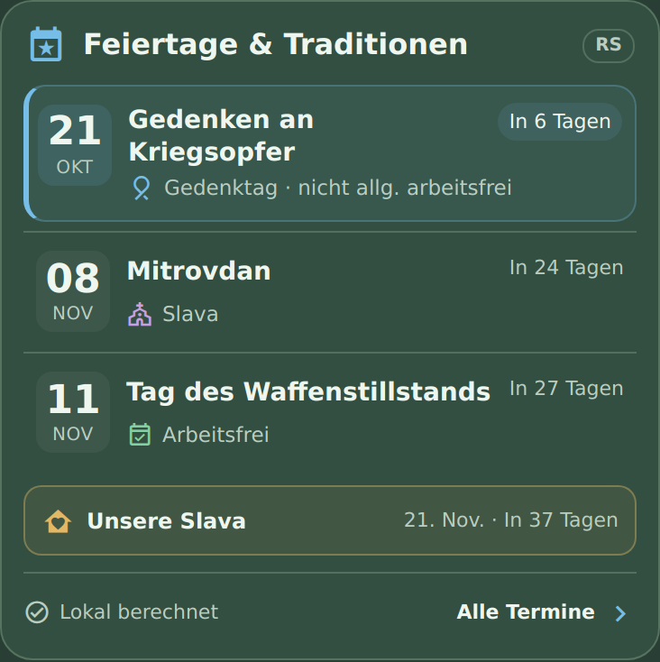

# Feiertage & Traditionen Serbien

Eine kompakte Home-Assistant-Karte für serbische Feiertage, Gedenktage und Traditionen. Drei schlanke Terminzeilen zeigen Datum, Art und Countdown. Der nächste Anlass ist dezent blau hervorgehoben; die eigene Familien-Slava erhält einen goldenen Akzent.



## Installation über HACS

1. HACS öffnen → Menü oben rechts → **Benutzerdefinierte Repositories**.
2. `https://github.com/AshenSage/ha-feiertage-serbien` eintragen.
3. Als Typ **Dashboard** wählen (in älteren HACS-Versionen **Lovelace**).
4. **Feiertage & Traditionen Serbien** herunterladen und die Seite neu laden.
5. Die bisherige Template-/button-card-Karte vollständig durch folgende manuelle Karte ersetzen:

```yaml
type: custom:feiertage-serbien-card
family_slava: Aranđelovdan
family_name: ""
```

Die Ressource wird durch HACS verwaltet. Falls sie nicht automatisch registriert wurde, unter **Einstellungen → Dashboards → Ressourcen** diese Ressource einmal als **JavaScript-Modul** hinzufügen:

```text
/hacsfiles/ha-feiertage-serbien/ha-feiertage-serbien.js
```

Die Karte ist ein Dashboard-Frontend. In HACS deshalb **Dashboard**, nicht **Integration**, auswählen. Es wird keine `manifest.json` benötigt.

## Familien-Slava

Voreingestellt ist **Aranđelovdan am 21. November** mit dem Label **Unsere Slava**. Der ursprüngliche Terminname bleibt sichtbar. Die Karte unterscheidet diese persönliche Markierung von allgemeinen arbeitsfreien Feiertagen.

- Steht die Slava in den nächsten drei Terminen, wird ihre Zeile golden markiert und mit einem Haus-/Herz-Symbol versehen.
- Liegt sie weiter in der Zukunft, erscheint eine schmale goldene Zeile mit Datum und Countdown unter der Liste.
- Am Feiertag steht **Heute**, am Vortag **Morgen**; nach dem Termin zählt die Karte zur nächsten jährlichen Slava.
- Das Antippen öffnet die Erklärung **Unser Familienfeiertag · Unsere Slava**.

Mit `family_name: Muster` wird daraus zum Beispiel **Slava Muster**. Trage hier deinen eigenen Familiennamen ein. Der Familienname wird nur in deiner lokalen Kartenkonfiguration gespeichert. Die Familienmarkierung ist konfigurierbar. Enthaltene Slavas: `Đurđevdan`, `Mitrovdan`, `Aranđelovdan`, `Nikoljdan`. `family_slava: false` schaltet die Markierung ab.

## Bedienung

Termine antippen, um den vollständigen Zeitraum, die Erklärung und die allgemeine Arbeitsfreiheit zu sehen. **Alle Termine** zeigt die nächsten zwölf Monate. **Lokal berechnet** erklärt die Datenbasis. Beide Ansichten lassen sich mit dem Schliessen-Button oder Escape verlassen.

## Optionen

| Option | Standard | Bedeutung |
| --- | --- | --- |
| `title` | `Feiertage & Traditionen` | Überschrift |
| `max_items` | `3` | Anzahl der Terminzeilen, 1–12 |
| `family_slava` | `Aranđelovdan` | Name einer hinterlegten Slava oder `false` |
| `family_name` | leer | Familienname im Label `Slava …`; leer ergibt `Unsere Slava` |
| `show_family_countdown` | `true` | Goldene Zusatzzeile, wenn die Slava ausserhalb der Terminliste liegt |
| `show_footer` | `true` | Informationen und „Alle Termine“ anzeigen |
| `time_zone` | HA-Zeitzone | Optional überschreiben, z. B. `Europe/Belgrade` |
| `entity` | keine | Optionaler Zusatzkalender, z. B. `calendar.serbien` |

```yaml
type: custom:feiertage-serbien-card
title: Feiertage & Traditionen
max_items: 3
family_slava: Aranđelovdan
family_name: ""
show_family_countdown: true
```

Die Farben und der Hintergrund passen sich dem Home-Assistant-Theme an. Eigene CSS-Variablen sind `--feiertage-next-color` und `--feiertage-family-color`.

## Daten und Offline-Betrieb

Die Karte rechnet im Browser ohne externe Dienste, API-Schlüssel oder zusätzliche Integration. Sie enthält die bisher verwendeten Traditionen und Gedenktage sowie Neujahr, Sretenje, Tag der Arbeit, den Tag des Waffenstillstands, Božić und die orthodoxen Ostertage. Sonntagsersatz wird nur für staatliche Feiertage berechnet, nicht für religiöse Feiertage. Samstag allein löst keinen Ersatzfeiertag aus; bestehende freie Tage werden bei der Ersatzberechnung übersprungen.

Die Tagesberechnung verwendet die Zeitzone von Home Assistant und echte Kalenderdaten. Sommerzeitwechsel verändern die Countdowns nicht. Eine interne Minutenprüfung hält die Karte auch ohne Sensoränderung über Mitternacht aktuell. Farben sind durch Symbole und Text ergänzt.

Die Regeln sind im Quellcode hinterlegt. Einmalige zusätzliche arbeitsfreie Tage und zukünftige Regeländerungen werden nicht automatisch aus dem Internet übernommen. `Arbeitsfrei` bedeutet allgemein arbeitsfreier Feiertag in Serbien; eine Slava wird dadurch nicht zu einem allgemeinen Feiertag.

Die Feiertage 2026 wurden gegen die [Liste der Nationalbank Serbiens](https://www.nbs.rs/en/o_nbs/radno-vreme-i-neradni-dani/) geprüft. Die Traditionen und Slava-Termine stammen aus der ursprünglichen Karte.

### Optionaler Zusatzkalender

```yaml
type: custom:feiertage-serbien-card
entity: calendar.serbien
family_slava: Aranđelovdan
family_name: ""
```

Die Kalender-Entität liefert nur einen Termin; die Karte ruft nicht den gesamten Kalender ab. Nur plausible ganztägige Termine mit einem aktuellen Zeitstempel werden ergänzt. `end_time` wird als exklusives Ende ausgewertet. Bekannte Namen und ihre hinterlegten englischen/serbischen Feiertagsnamen werden bei passenden Zeiträumen nicht doppelt angezeigt. Zusatztermine erhalten **Arbeitsfreiheit ungeprüft**. Bei fehlenden oder alten Kalenderdaten bleiben die lokal berechneten Termine verfügbar; Hinweise stehen in der Informationsansicht.

## Manuelle Installation

`ha-feiertage-serbien.js` nach `/config/www/ha-feiertage-serbien.js` kopieren und `/local/ha-feiertage-serbien.js` als JavaScript-Modul registrieren. Anschliessend dieselbe Karten-YAML verwenden.

## Entwicklung und Releases

Keine Laufzeitabhängigkeiten. Node.js 22 oder neuer genügt:

```sh
npm run check
```

`src/model.js` enthält die Kalenderlogik, `src/card.js` die Karte und `src/card.css` das Layout. Der Build erstellt die einzige für HACS benötigte Datei `ha-feiertage-serbien.js` im Repository-Hauptverzeichnis.

Bei Änderungen `package.json` hochzählen, Bundle neu bauen und `RELEASE_NOTES.md` aktualisieren. Der Workflow prüft Build und Tests und veröffentlicht danach einen normalen Release mit JS-Anhang. Es werden keine Vorabversionen erstellt. Bereits vorhandene Releases werden nicht überschrieben.

Ein optionaler Browsertest ist in `test/browser.mjs` enthalten. Er benötigt lokal Playwright und Chromium; `PLAYWRIGHT_MODULE` und `CHROMIUM_PATH` können bei Bedarf gesetzt werden.

## Technische Referenzen

- [Home Assistant: Custom Cards](https://developers.home-assistant.io/docs/frontend/custom-ui/custom-card/)
- [HACS: Dashboard-Repositories](https://hacs.dev/docs/publish/plugin/)
